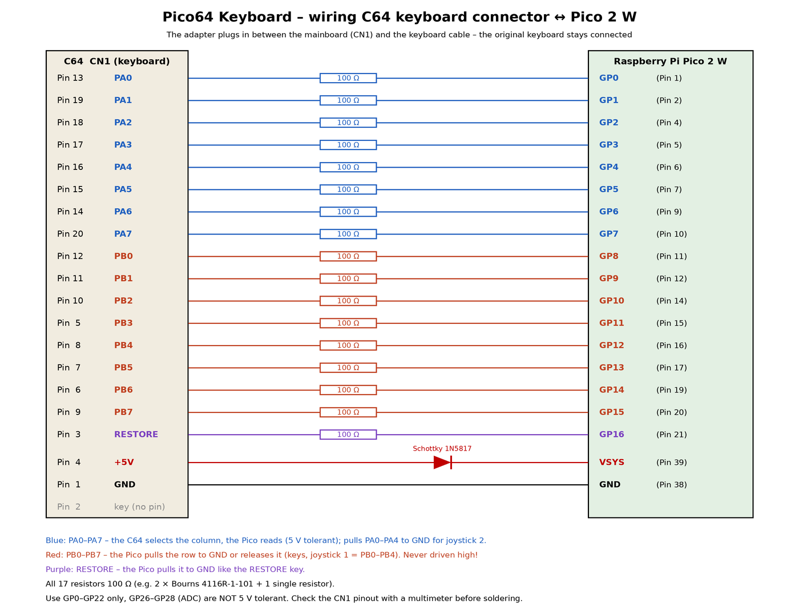

# Pico64 Keyboard

*English version: [README.md](README.md)*

Ein kleiner Adapter, der aus einem **Raspberry Pi Pico 2 W** eine kabellose Tastatur- und
Joystick-Schnittstelle für den **Commodore 64** macht – bedient vom Handy mit der
[Blue-64-Keyboard-App](https://github.com/do2mad/blue64-keyboard-ios) (iPhone und Android),
mit einer **Bluetooth-Tastatur** oder einem **Bluetooth-Gamepad** (z. B. 8BitDo).

**App bekommen:** iPhone – [TestFlight-Beta](https://testflight.apple.com/join/jEn4tsP7) · Android – [APK im neuesten Release](https://github.com/do2mad/blue64-keyboard-ios/releases/latest)

Der Pico wird zwischen C64-Mainboard und Tastaturkabel gesteckt und bildet die Tastaturmatrix in
Software nach. Außer dem Pico braucht es nur **17 Widerstände und eine Diode** – keine
Pegelwandler und kein Koppelfeld-Chip, denn GPIO 0–25 des RP2350 sind 5-V-tolerant.
Originaltastatur und Joysticks funktionieren weiter.

## Funktionen

- Bildet die komplette 8×8-Tastaturmatrix plus RESTORE nach – beliebig viele Tasten gleichzeitig
- Reagiert in etwa 70 ns auf jede Spalte, die der C64 auswählt (Kern 1 arbeitet mit einer
  Tabelle aus dem RAM) – auch Programme, die mehrere Spalten gleichzeitig abfragen, funktionieren
- Derselbe Bluetooth-LE-Dienst wie die BT-64-/Blue-64-Firmware mit BLE-Tastaturdienst –
  die Blue-64-Keyboard-App funktioniert unverändert (der Pico heißt dort **Pico64**)
- Texte und kurze BASIC-Listings aus der App tippen lassen (Textbausteine)
- **Bluetooth-Tastaturen** (Classic und BLE) – deutsches QWERTZ-Layout wird so getippt, wie es
  aufgedruckt ist, oder positionsgleich für Spiele (F10 schaltet um)
- **Bluetooth-Gamepads** (8BitDo, Xbox, PlayStation, Switch und viele mehr, über
  [Bluepad32](https://github.com/ricardoquesada/bluepad32)) als **Joystick in Port 1 oder 2**
- App, Tastatur und Gamepads gleichzeitig nutzbar; **zwei App-Geräte** (z. B. iPhone und iPad) zugleich
- USB-Konsole: jede im Terminal eingegebene Zeile wird auf dem C64 getippt, dazu ein Tasten-Protokoll zur Fehlersuche
- Stromversorgung aus dem C64

## Stand

**v0.12.0 – funktioniert.** An einem Brotkasten-C64 mit iPhone und Android-Handy getestet,
zuerst auf Lochraster, jetzt auf einer eigenen **Platine** (Gerber-Dateien, Stückliste und Fotos in
[hardware/](hardware/)). Bluetooth-Tastatur und -Gamepad müssen noch mit mehr Geräten getestet werden.

> **Hardware-Änderung in v0.10:** alle 17 Widerstände sind jetzt 100 Ω (PA0–PA7 waren 1 kΩ).
> Joystick-Port 2 braucht das – alles andere geht auch mit den alten Werten. Siehe [docs/HARDWARE.md](docs/HARDWARE.md).

## Loslegen

1. **Adapter bauen** – Platine (Gerber-Dateien, Stückliste): [hardware/](hardware/); Verdrahtung und
   Sicherheitshinweise, auch für Lochraster: [docs/HARDWARE.md](docs/HARDWARE.md) (englisch).
   Die Belegung von CN1 am eigenen C64 vor dem Löten mit dem Multimeter prüfen.
2. **Firmware aufspielen** – BOOTSEL gedrückt halten, Pico per USB an den Rechner, die Datei
   `pico64-keyboard-vX.Y.Z.uf2` aus dem [neuesten Release](https://github.com/do2mad/pico64-keyboard/releases/latest)
   auf das Laufwerk `RP2350` ziehen. Dabei den Pico **nicht** im laufenden C64 stecken lassen.
3. **Einstecken** zwischen CN1 und Tastaturkabel, C64 einschalten – die LED am Pico blinkt
   (noch nichts verbunden).
4. **Mit der App verbinden** – [Blue-64 Keyboard](https://github.com/do2mad/blue64-keyboard-ios)
   findet den Pico selbst, die LED leuchtet dauerhaft, solange verbunden.
5. **Oder Bluetooth-Tastatur / Gamepad koppeln** – siehe unten.

Firmware selbst bauen: [docs/BUILDING.md](docs/BUILDING.md). Bluetooth-Protokoll: [docs/PROTOCOL.md](docs/PROTOCOL.md).

## Bluetooth-Tastatur und Gamepad

Der Pico sucht ständig nach Tastaturen und Gamepads. Zum Koppeln das Gerät in den Pairing-Modus
bringen – es verbindet sich nach ein paar Sekunden von selbst (keine PIN, keine App nötig).
Gekoppelte Geräte verbinden sich beim Einschalten automatisch wieder. Bis zu 4 Bluetooth-Verbindungen
gleichzeitig (Apps, Tastaturen und Gamepads zusammen).

- **Tastatur:** meist die Bluetooth-/Pairing-Taste (oder Fn + Kanaltaste) 3 s halten, siehe
  Anleitung der Tastatur. Fragt die Tastatur nach einem Code: `0000` und Enter tippen.
- **8BitDo-Gamepads:** im **Android-/D-Input-Modus** einschalten (viele Modelle: **B + Start**
  halten) oder im **Switch-Modus** (**Y + Start**), dann die Pair-Taste 3 s halten. Die Modi
  unterscheiden sich je nach Modell – siehe 8BitDo-Anleitung und die
  [Bluepad32-Liste unterstützter Controller](https://bluepad32.readthedocs.io/).
- **Andere Gamepads** (Xbox, PlayStation, Switch Pro …): normaler Pairing-Modus.

### Tastaturbelegung

Zwei Modi, **F10** schaltet um (die USB-Konsole zeigt den aktuellen Modus):

| Modus | Wirkung |
|---|---|
| **Symbolisch** (Standard) | Tippt, was auf der **deutschen** Tastatur steht: Shift+0 ergibt `=`, Shift+2 `"`, AltGr+Q `@`, Z und Y an der richtigen Stelle. Zeichen, die der C64 nicht hat (ä ö ü ß € …), werden ignoriert. |
| **Positionsgleich** | Jede Taste wirkt wie die C64-Taste an derselben Stelle, SHIFT bleibt SHIFT – am besten für Spiele und die Grafikzeichen. |

| PC-Taste | C64-Taste |
|---|---|
| Esc | RUN/STOP |
| Tab | CTRL |
| Strg | CTRL |
| Alt, Windows/Cmd | C= |
| Rücktaste, Entf | INST/DEL |
| Pos1 | CLR/HOME |
| Einfg | £ |
| F1 – F8 | F1 – F8 |
| F9, Bild auf, Pause | RESTORE |
| Pfeiltasten | CRSR (hoch/links automatisch mit SHIFT) |
| F10 | Belegung umschalten |

### Gamepad

| Gamepad | C64 |
|---|---|
| Steuerkreuz oder linker Stick | Joystick-Richtungen |
| A, B | Feuer |
| X | SPACE |
| Y | RETURN |
| Select / − | RUN/STOP |
| Start / + | F1 |
| L1 + R1 zusammen | Joystick-Port wechseln (1 ↔ 2) |

Das erste Gamepad spielt an **Port 2** (die meisten Spiele), ein zweites an Port 1.

## USB-Tastatur (ohne C64)

Platine aus dem C64 nehmen, das Tastaturkabel des C64 daran anschließen und den Pico per USB mit
Mac, PC, Raspberry Pi oder MiSTer verbinden: Die **echte C64-Tastatur wird zur USB-Tastatur**.
App und Bluetooth-Tastaturen funktionieren gleichzeitig und gehen ebenfalls per USB raus.

Der Pico entscheidet beim Start: Ohne USB-Spannung kann ihn nur der C64 versorgen → C64-Modus.
Mit USB-Spannung lauscht er 0,6 s, ob ein C64 die Tastatur abfragt → C64-Modus, sonst
USB-Tastatur. Fängt ein C64 später an abzufragen, startet der Pico von selbst im C64-Modus neu.
Ein ausgeschalteter, aber angeschlossener C64 zieht die Leitungen herunter – dann bleibt der
Pico im C64-Modus (die USB-Tastatur geht nur mit der Platine außerhalb des C64).

Die Ausgabe wählt man mit **RESTORE + F-Taste** (wird gespeichert):

| Tasten | Ausgabe |
|---|---|
| RESTORE + F1 | MiSTer, C64-Core (Tasten so, wie der Core sie erwartet; RESTORE allein = F11) |
| RESTORE + F3 | PC, deutsches Layout |
| RESTORE + F5 | PC, US-Layout |
| RESTORE + F7 | Mac, deutsches Layout |
| RESTORE + F8 (SHIFT + F7) | Mac, US-Layout |

PC / Mac: Es kommt an, was auf der Taste steht (SHIFT + 2 = `"`, SHIFT + `:` = `[`). DEL = Backspace,
INST = Einfg, CRSR = Pfeiltasten, F1–F8, HOME / CLR = Pos1 / Ende, RUN/STOP = Esc, ← = Tab,
CTRL = Strg, C= = Win / Cmd, £ = `\`. Wie beim Original hat die Tastatur keine Dioden, bei manchen
Dreier-Kombinationen erscheint deshalb eine Phantomtaste.

In der USB-Konsole zeigt `!u` den Modus, `!u0` … `!u4` wählen die Ausgabe.

## USB-Konsole

Pico per USB anschließen, während er im C64 steckt (die Diode schützt beide Seiten), und ein
Terminal mit 115200 Baud öffnen, z. B. auf dem Mac `screen /dev/tty.usbmodem* 115200`.

- Jede eingegebene Zeile wird auf dem C64 getippt, danach RETURN (Buchstaben ungeshiftet,
  `~clr~`, `~home~`, `~f1~` usw. funktionieren).
- Eine Zeile nur mit `d` schaltet das Tasten-Protokoll an/aus: jeder per Bluetooth empfangene
  Tastenzustand und jeder an die Matrix angelegte Zustand mit Zeitstempel, dazu das Verbindungsintervall.
- `!s` Status (App, Tastaturen, Gamepads, Joystick-Ports), `!p` Tastaturbelegung umschalten,
  `!b` Suche nach neuen Bluetooth-Geräten an/aus, `!x` alle gekoppelten Tastaturen/Gamepads vergessen,
  `!u` USB-Tastatur-Modus (siehe oben).

## Sicherheit

- Der Pico **treibt nie eine C64-Leitung auf High** – PB0–PB7, RESTORE und (für Joystick 2)
  PA0–PA4 werden nur nach Masse gezogen oder losgelassen (Open-Drain), wie es ein Tastenschalter
  oder ein Joystick tut.
- Nur GP0–GP22 verwenden. GP26–GP28 sind **nicht** 5-V-tolerant, GP23–25 und GP29 gehören dem Funkchip.
- Die 5-V-Toleranz gilt nur, solange der Pico versorgt ist – durch die Speisung aus dem C64 ist das immer der Fall.
- Nachbau auf eigene Gefahr. Verdrahtung doppelt prüfen.

## Verwandte Projekte

- [Blue-64 Keyboard](https://github.com/do2mad/blue64-keyboard-ios) – die App (iPhone und Android)
- [Pico USB Keyboard](https://github.com/do2mad/pico-usb-keyboard) – dieselbe App als USB-Tastatur:
  ein Pico 2 W ohne Verkabelung, für den C64-Core des MiSTer, PC, Mac oder Raspberry Pi
- [BT-64 mit BLE-Tastaturdienst](https://github.com/do2mad/BT-64/tree/ble-keyboard) – die
  Firmware-Erweiterung für den BT-64 / Blue-64

## Dank und Lizenz

- Firmware © 2026 Martin Oswald (do2mad) – [1mhz.de](https://1mhz.de), [MIT-Lizenz](LICENSE)
- Hardware (Schaltplan, Platine) © 2026 Martin Oswald, [CC BY-NC-SA 4.0](LICENSE-HARDWARE.md) – nicht-kommerziell
- Nutzt Raspberry Pi Pico SDK, BTstack, den CYW43-Treiber und
  [Bluepad32](https://github.com/ricardoquesada/bluepad32) von Ricardo Quesada – siehe [NOTICE](NOTICE)
- Der Bluetooth-Dienst folgt dem Protokoll der BLE-Tastatur-Erweiterung für
  [BT-64 / Blue-64](https://github.com/sideprojectslab/BT-64) von SideProjectsLab
- Belegung des C64-Tastatursteckers nach Ruud Baltissen

Änderungen: [CHANGELOG.md](CHANGELOG.md)

Commodore und Commodore 64 sind Marken ihrer jeweiligen Inhaber. Dieses Projekt steht in keiner
Verbindung zu ihnen, zu Raspberry Pi Ltd. oder zu SideProjectsLab.
