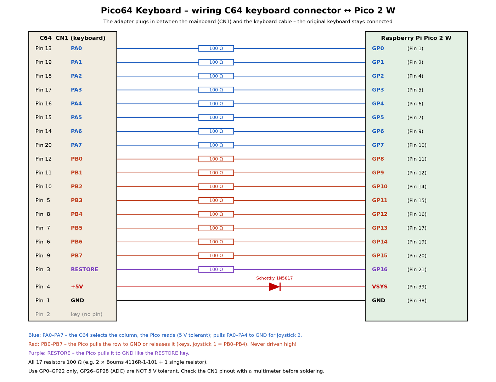

# Hardware

*English version: [HARDWARE.md](HARDWARE.md)*

## So funktioniert es

Der C64 fragt seine Tastatur über CIA 1 ab:

1. Er schreibt `$DC00` (Port **A**, PA0–PA7) und zieht eine oder mehrere **Spalten** auf Low.
2. Ein paar Mikrosekunden später liest er `$DC01` (Port **B**, PB0–PB7). Jede gedrückte Taste in
   einer aktiven Spalte verbindet ihre **Zeile** mit dieser Spalte und zieht die PB-Leitung auf Low.

Der Pico macht genau das, was die Tastenschalter tun würden:

- **Kern 1** liest PA0–PA7 in einer engen Schleife und schlägt in einer Tabelle mit 256 Einträgen
  nach, welche PB-Leitungen bei diesem Spaltenmuster auf Low müssen. Reaktionszeit etwa 60–80 ns
  (9 Befehle bei 150 MHz, Code im RAM). Der C64 liest erst einige Mikrosekunden später.
- **Kern 0** erledigt Bluetooth (BTstack + Bluepad32): den Dienst für die App, Bluetooth-Tastaturen
  und Gamepads. Er hält jede Tastenänderung lange genug für das KERNAL (das alle 1/60 s abfragt) und
  baut bei jeder Änderung die Tabelle neu. Außerdem laufen dort das Texttippen, die USB-Konsole und
  der Kabeleingang für das CBM2 Keyboard.

**Joysticks** nutzen dieselben Leitungen: Port 1 = PB0–PB4, Port 2 = PA0–PA4 (hoch, runter, links,
rechts, Feuer); ein echter Joystick schließt sie einfach nach Masse kurz. Gamepad-Port 1 wird in
jeden Tabelleneintrag hineingeodert; für Port 2 zieht der Pico PA0–PA4 selbst auf Low – genau wie
ein Joystick in Port 2.

Weil die Tabelle **jedes** Spaltenmuster abdeckt, funktionieren auch Programme, die mehrere Spalten
gleichzeitig wählen (z. B. `$DC00 = 0` für „irgendeine Taste?“), und beliebig viele Tasten können
gleichzeitig gedrückt sein.

### Die eine Regel

Alle C64-Leitungen werden **nur nach Masse gezogen oder losgelassen** (Open-Drain): PB0–PB7 und
RESTORE für Tasten und Joystick 1, PA0–PA4 für Joystick 2. Der Pico treibt keine davon auf High.
So bleibt er verträglich mit der echten Tastatur, den Joystick-Ports (die dieselben Leitungen
nutzen) und der CIA – und es fließt kein Strom in den C64, wenn der C64 aus ist und der Pico über
USB versorgt wird.

## Warum der Pico 2 W

| Tatsache | Folge |
|---|---|
| RP2350: GPIO 0–25 sind **5-V-tolerant** (solange der Chip versorgt ist) | PA-Leitungen direkt lesbar, keine Pegelwandler |
| GPIO 26–29 (ADC) sind **nicht** 5-V-tolerant | dort nie etwas vom C64 anschließen |
| Beim Pico 2 W gehören GPIO 23, 24, 25 und 29 dem Funkmodul | frei und 5-V-tolerant: **GP0–GP22** |
| Absolutes Maximum 5,5 V je Pin | den C64 nur mit einem gesunden Netzteil betreiben |
| BTstack ist Teil des Pico SDK | derselbe Bluetooth-Stack wie beim BT-64, der Dienst ist kompatibel |

## Verdrahtung

| C64 CN1 | Signal | Widerstand | Pico | Pico-Pin |
|---|---|---|---|---|
| 13 | PA0 | 100 Ω | GP0 | 1 |
| 19 | PA1 | 100 Ω | GP1 | 2 |
| 18 | PA2 | 100 Ω | GP2 | 4 |
| 17 | PA3 | 100 Ω | GP3 | 5 |
| 16 | PA4 | 100 Ω | GP4 | 6 |
| 15 | PA5 | 100 Ω | GP5 | 7 |
| 14 | PA6 | 100 Ω | GP6 | 9 |
| 20 | PA7 | 100 Ω | GP7 | 10 |
| 12 | PB0 | 100 Ω | GP8 | 11 |
| 11 | PB1 | 100 Ω | GP9 | 12 |
| 10 | PB2 | 100 Ω | GP10 | 14 |
| 5 | PB3 | 100 Ω | GP11 | 15 |
| 8 | PB4 | 100 Ω | GP12 | 16 |
| 7 | PB5 | 100 Ω | GP13 | 17 |
| 6 | PB6 | 100 Ω | GP14 | 19 |
| 9 | PB7 | 100 Ω | GP15 | 20 |
| 3 | RESTORE | 100 Ω | GP16 | 21 |
| 4 | +5 V | Schottky 1N5817 (Anode am C64) | VSYS | 39 |
| 1 | GND | – | GND | 38 |
| 2 | Kodierung (kein Pin) | | | |

Belegung von CN1 nach Ruud Baltissen („Commodore 64 keyboard connector and keyboard matrix“).
**Vor dem Löten mit dem Multimeter prüfen** – GND (1), +5 V (4) und RESTORE (3) sind leicht zu
messen, PA/PB per Durchgang zur CIA 1 (Pins 2–9 = PA0–PA7, 10–17 = PB0–PB7).

### Kabel zum CBM2 Keyboard (Platine V2, J3)

Das [CBM2 Keyboard](https://github.com/do2mad/cbm2-keyboard) (eine CBM-II-Tastatur am C64) wird
mit einem 4-poligen JST-XH-Kabel angeschlossen, 1:1 verdrahtet:

| J3 | Pico64 | CBM2 Keyboard |
|---|---|---|
| 1 | GP17 (Pin 22), UART0 RX, Pull-up | GP28 über 330 Ω – Daten, 115200 Baud |
| 2 | GND | GP22 – Kabel-Erkennung |
| 3 | VSYS (hinter D1) | → 1N5817 → VSYS – Strom vom C64 |
| 4 | GND | GND |

Protokoll: siehe [PROTOCOL.de.md](PROTOCOL.de.md#kabeleingang-cbm2-keyboard). Firmware ab 0.13.1.
Bei einem Adapter auf Lochraster lässt sich dieselbe Buchse nachrüsten.

### Warum diese Widerstände

Alle 17 Widerstände sind **100 Ω**.

- **PA-Leitungen:** Der Pico liest sie und zieht PA0–PA4 für Joystick-Port 2 auf Low. Bis v0.9.1
  waren es 1 kΩ – gut zum Lesen, aber zu viel, um eine Leitung gegen den Pull-up der CIA weit genug
  herunterzuziehen (Joystick 2 ging nicht zuverlässig). Adapter mit 1 kΩ in PA funktionieren für
  die Tastatur und Joystick-Port 1 weiterhin. Prüfen: an einem Gamepad auf Port 2 „hoch“ halten
  und PA0 an CN1 Pin 13 messen – unter 0,4 V ist gut.
- **PB-Leitungen und RESTORE:** Schutz, aber klein genug, damit der Low-Pegel gegen die Pull-ups
  sicher unter der Eingangsschwelle der CIA bleibt (VIL max. 0,8 V). Die Pull-ups eines
  echten Brotkastens haben etwa 2,4 kΩ: mit 100 Ω geht die Leitung auf etwa 0,3 V herunter, mit den
  330 Ω des ersten Prototyps nur auf 0,69 V – zu knapp, manche kurzen Tastendrücke fehlten.
  Die Firmware treibt diese Pins mit 12 mA und nie auf High, daher reichen 100 Ω als Schutz.
  Prüfen: in der App eine Taste halten und die PB-Leitung an CN1 messen – unter 0,4 V ist gut.
- **Schottky-Diode:** Der Pico wird aus den +5 V des C64 versorgt. Ist zusätzlich USB angeschlossen,
  verhindert die Diode, dass der Pico den C64 über VSYS speist (VBUS→VSYS hat auf dem Pico-Board
  schon eine Diode).

Der Pico muss laufen, solange der C64 läuft (die 5-V-Toleranz braucht Versorgungsspannung) – die
Speisung aus dem C64 stellt das sicher.

## Stückliste

| Anzahl | Bauteil | Hinweis |
|---|---|---|
| 1 | Raspberry Pi Pico 2 W | mit Stiftleisten oder direkt aufgelötet |
| 17 | Widerstand 100 Ω | oder 2 × Widerstandsnetzwerk 8 × 100 Ω, isoliert (Bourns 4116R-1-101) + 1 Einzelwiderstand (RESTORE) |
| 1 | Schottky-Diode 1N5817 (oder BAT54 SMD) | |
| 1 | Buchsenleiste 1 × 20, 2,54 mm | kommt auf CN1 der Hauptplatine |
| 1 | Stiftleiste 1 × 20, 2,54 mm | für den Stecker des Tastaturkabels |
| 1 | JST-XH-Buchse 4-polig (optional) | Kabel zum CBM2 Keyboard |
| 1 | Platine (siehe unten) oder Lochraster | |

Materialkosten etwa 10–15 €.

## Mechanik

Der Adapter ist ein **Zwischenstecker**: Die Buchsenleiste sitzt auf CN1 der Hauptplatine, die
Stiftleiste darüber nimmt den Stecker des Tastaturkabels auf, alle 20 Leitungen sind 1:1 verbunden.
Der Pico greift die Leitungen über die Widerstände ab. Auf den Kodierplatz (Pin 2) achten, damit
das Tastaturkabel nicht verkehrt herum aufgesteckt werden kann.

Es gibt zwei **Platinen** – Gerber-Dateien, Stücklisten und Fotos in [../hardware/](../hardware/README.de.md):

- **V2** (aktuell): Der Pico sitzt oben auf, direkt aufgelötet oder mit Leisten gesteckt, dazu die
  JST-XH-Buchse J3 für das CBM2 Keyboard. 47 × 68 mm.
- **V1**: Der Pico wird flach in eine Aussparung gelötet, so passt der Adapter unter das
  Gehäuseoberteil. 53 × 68 mm.

## Testplan

1. **Ohne C64:** Firmware aufspielen, die LED blinkt, die USB-Konsole zeigt
   „Pico64 Keyboard v… starting“. Die App findet „Pico64“ und verbindet sich (LED leuchtet).
2. **Messen ohne C64:** GP8–GP15 dürfen nie aktiv High (3,3 V) sein – gegen GND messen, während
   in der App Tasten gedrückt werden.
3. **Im C64, zuerst nur Strom:** Adapter einstecken, C64 einschalten, die LED blinkt, die
   Originaltastatur tippt normal.
4. **USB-Konsole:** `print"hallo"` + RETURN eingeben → erscheint auf dem C64.
5. **App:** Tippen, SHIFT / C= / CTRL, RESTORE mit RUN/STOP, Zeichensatz umschalten, Textbausteine.
6. **Joysticks:** Joysticks an Port 1 und 2 funktionieren weiter, auch während die App verbunden ist.
7. **Bluetooth-Tastatur / Gamepad:** koppeln (siehe README), tippen, ein Spiel an Port 2 spielen,
   mit L1 + R1 das Gamepad auf Port 1 wechseln.
8. **CBM2 Keyboard (V2):** Kabel einstecken, die LED des CBM2 Keyboards blitzt alle 4 s,
   C= + F10 auf der CBM-II-Tastatur tippt dessen Version.
9. **Spiele:** ein paar Spiele mit Tastatursteuerung, auch solche, die mehrere Spalten gleichzeitig abfragen.

## Bekannte Einschränkungen / Ideen

- **Umgekehrte Abfrage:** Einige wenige Programme treiben PB und lesen PA. Das bildet die Firmware
  (noch) nicht nach; es ginge mit einer zweiten Tabelle und den PA-Pins als Open-Drain-Ausgänge.
- **Kopplung / Erlaubnisliste:** Wie bei der BT-64-Erweiterung kann sich jeder in Reichweite mit
  der App verbinden.
- **Joystick in der App:** Die Joystick-Nachbildung ist da (Gamepads nutzen sie) – eine
  Joystick-Ansicht in der App wäre fast geschenkt.
- **Beim Koppeln:** Wird ein neues Bluetooth-Gerät gekoppelt, schreibt der Pico den Schlüssel in
  den Flash, und Kern 1 pausiert einige Millisekunden – in diesem Moment gehaltene Tasten können
  kurz falsch ankommen.
- **Paddles / Maus:** nicht unterstützt (sie brauchen die analogen POT-Leitungen, die nicht an CN1 liegen).
