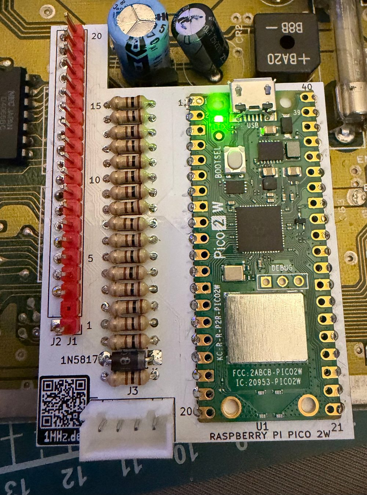
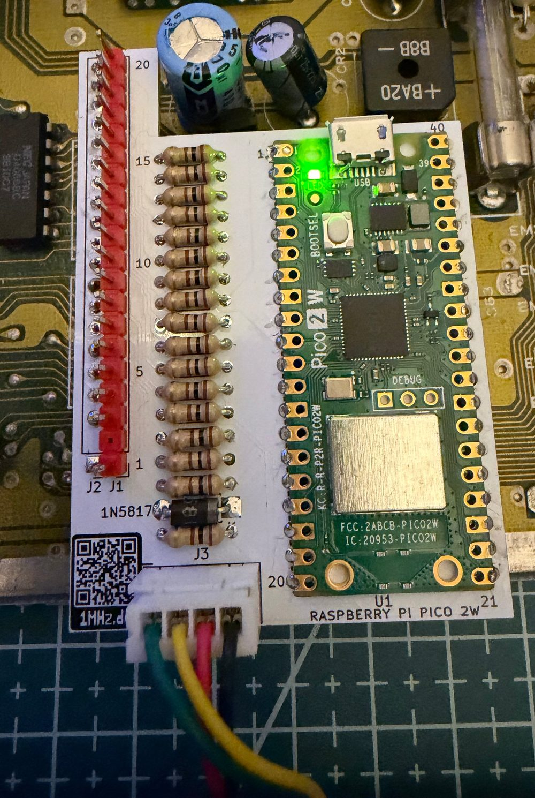
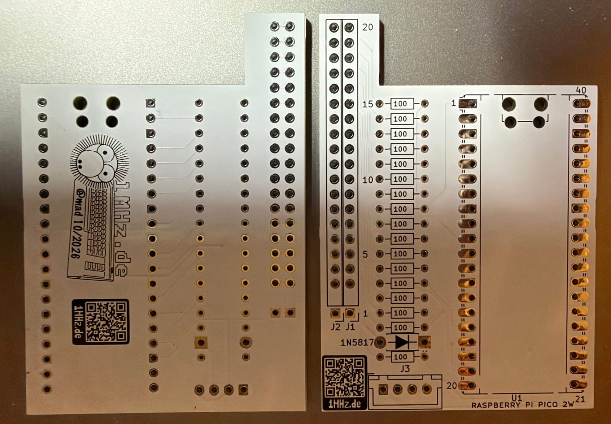
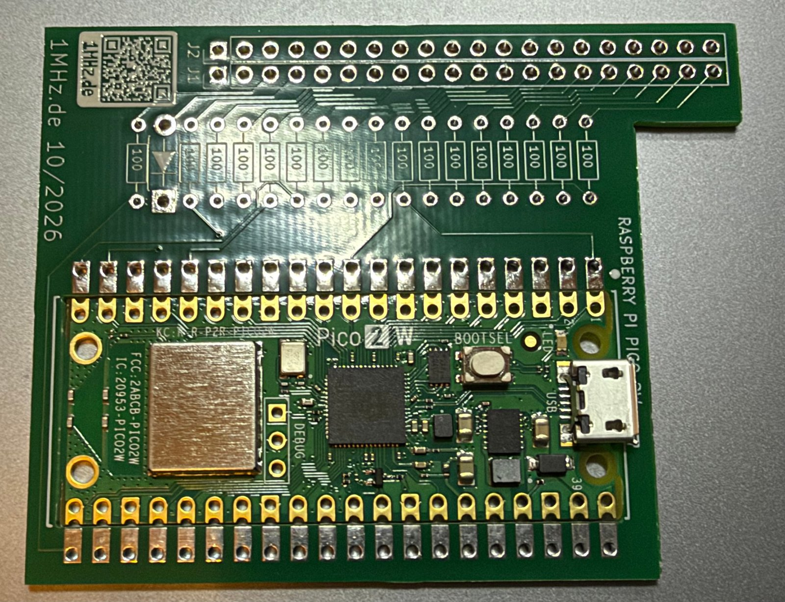
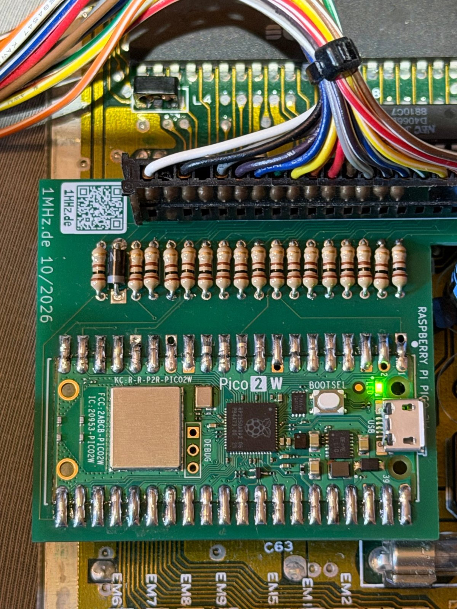
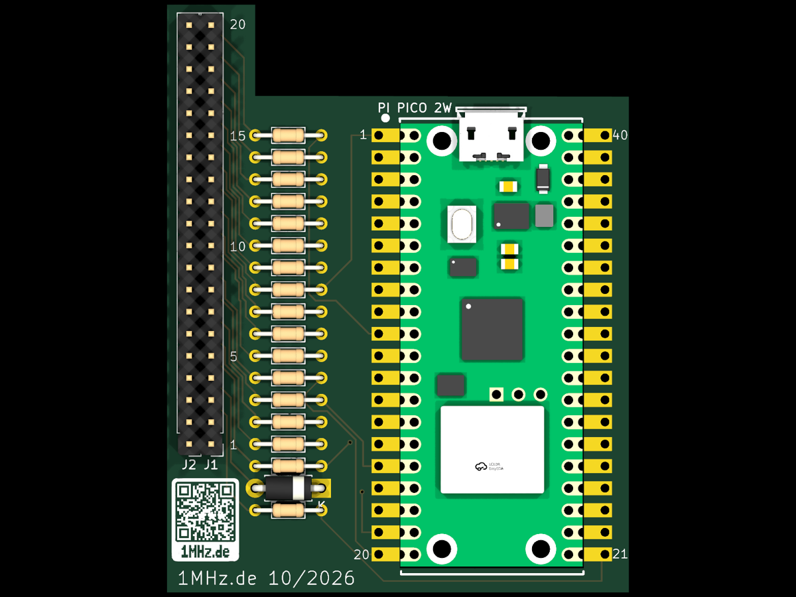
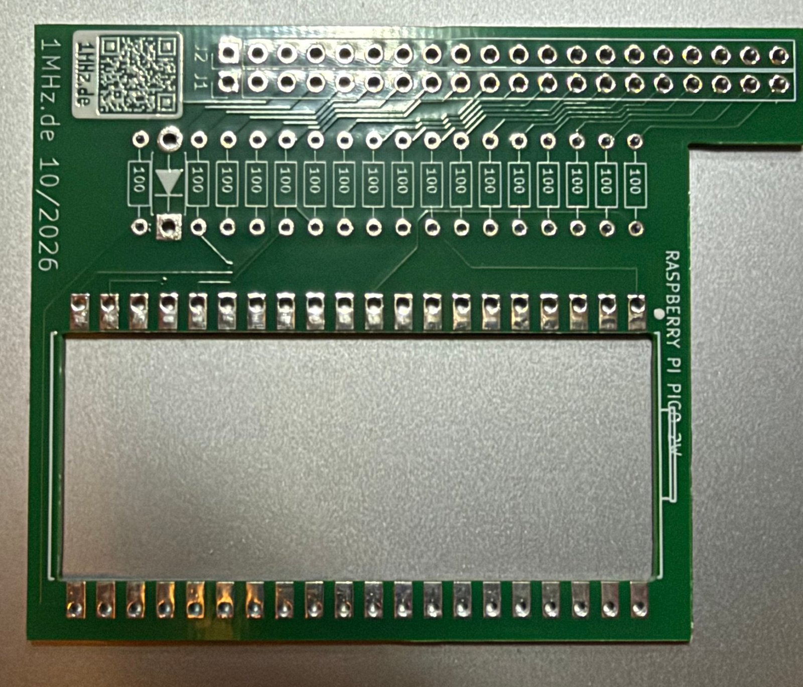

# Hardware (Platine)

[English](README.md)

Platine für **Pico64 Keyboard**: ein Zwischenstecker für den C64-Tastaturanschluss CN1 mit einem
Raspberry Pi Pico 2 W, 17 × 100 Ω und einer Schottky-Diode. Es gibt zwei Versionen; die Schaltung
für den C64 ist bei beiden gleich, die Firmware auch.

| | **V2** (aktuell, weiß) | **V1** |
|---|---|---|
| Pico 2 W | **oben auf** der Platine: direkt aufgelötet oder mit Stift-/Buchsenleisten gesteckt | flach **in eine Aussparung** gelötet (Castellated-Kanten) |
| Anschluss für das [CBM2 Keyboard](https://github.com/do2mad/cbm2-keyboard) | **J3**, JST-XH 4-polig | – (nur per Bluetooth) |
| Größe | 47 × 68 mm | 53 × 68 mm |
| Gerber | [gerber/pico64-keyboard-gerber-v2.0.zip](gerber/pico64-keyboard-gerber-v2.0.zip) | [gerber/pico64-keyboard-gerber-v1.1.zip](gerber/pico64-keyboard-gerber-v1.1.zip) |
| Stückliste | [Pico64-keyboard-V2-bom.csv](Pico64-keyboard-V2-bom.csv) | [Pico64-keyboard-bom.csv](Pico64-keyboard-bom.csv) |

Beide: 2 Lagen, 1,6 mm, nur bedrahtete Bauteile. Im Brotkasten-C64 getestet.

V2 hat unter der Antenne des Pico 2 W einen Ausschnitt in der Platine (besserer Funkempfang).
Gerber-Stand 07.11.2026: Ausschnitt und überarbeiteter Bestückungsdruck – die Kupferlagen sind
unverändert, frühere V2-Platinen funktionieren genauso.

## V2

| | |
|---|---|
|  |  |
| V2 im C64, Pico direkt aufgelötet | mit Kabel zum CBM2 Keyboard an J3 |

*V2 unbestückt – links die Unterseite, rechts die Oberseite.*

### Pico aufsetzen

- **Direkt aufgelötet** (wie auf dem Foto): Pico ohne Stiftleisten flach auf die Pads legen und an
  den Castellated-Kanten verlöten. Das ist die niedrigste Bauform und passt unter das Gehäuseoberteil.
- **Gesteckt:** Stiftleisten an den Pico, Buchsenleisten auf die Platine – der Pico lässt sich dann
  abnehmen. Vorher die Bauhöhe im eigenen C64-Gehäuse prüfen.

### Bauteile V2

| Anzahl | Bauteil | |
|---|---|---|
| 1 | Raspberry Pi Pico 2 W | U1, aufgelötet oder gesteckt (dann 2 × Stift- und Buchsenleiste 1 × 20) |
| 17 | Widerstand 100 Ω, 1/4 W (DIN0204, 7,62 mm) | R1–R17 |
| 1 | Schottky-Diode 1N5817 (DO-41) | D1, Anode an +5 V vom C64 |
| 1 | Buchsenleiste 1 × 20, 2,54 mm | J2, unten, auf CN1 der Hauptplatine |
| 1 | Stiftleiste 1 × 20, 2,54 mm | J1, oben, hier kommt der Stecker des Tastaturkabels drauf |
| 1 | JST-XH-Buchse 4-polig, stehend (B4B-XH-A) | J3, Kabel zum CBM2 Keyboard – nur nötig, wenn man es nutzt |

### J3 – Kabel zum CBM2 Keyboard

| J3 | Pico64 | |
|---|---|---|
| 1 | GP17 (Pin 22) | Daten vom CBM2 Keyboard, 115200 Baud |
| 2 | GND | Kabel-Erkennung für das CBM2 Keyboard |
| 3 | VSYS (hinter D1) | Strom für das CBM2 Keyboard |
| 4 | GND | |

Das Kabel ist 1:1 verdrahtet. Firmware ab **0.13.1**. Ohne Kabel ändert sich nichts.

## V1

| | |
|---|---|
|  |  |
| bestückt | im C64 (auf CN1, Tastaturkabel oben drauf) |
|  |  |
| 3D-Ansicht (KiCad) | unbestückte Platine |

Der Pico 2 W wird ohne Stiftleisten flach in die Aussparung gelötet – Pads verzinnen, dann Kante
für Kante löten, das braucht etwas Geduld. Bauteile wie V2, nur ohne J3.
v1.1: keine Bohrungen an Pin 2 von J1/J2 (Kodierung des Steckers) und Pin-Nummern im
Bestückungsdruck. Die Platinen auf den Fotos sind v1.0 – sonst identisch.

## Vor dem Einstecken

Die Belegung von CN1 am eigenen C64 mit dem Multimeter prüfen (GND Pin 1, +5 V Pin 4, RESTORE
Pin 3). Verdrahtung, Pin-Tabelle und Sicherheitshinweise: [../docs/HARDWARE.de.md](../docs/HARDWARE.de.md).

## Lizenz

CC BY-NC-SA 4.0, siehe [../LICENSE-HARDWARE.md](../LICENSE-HARDWARE.md).
