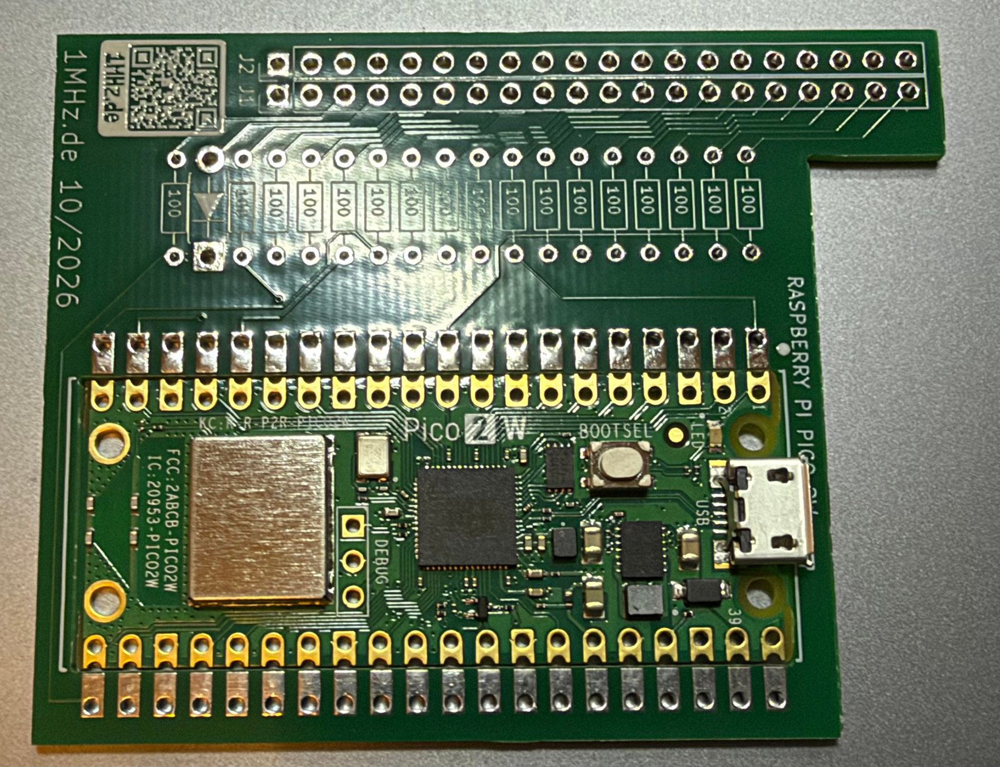
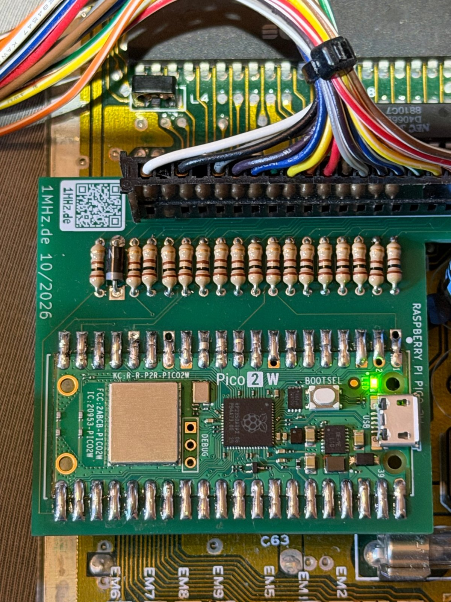
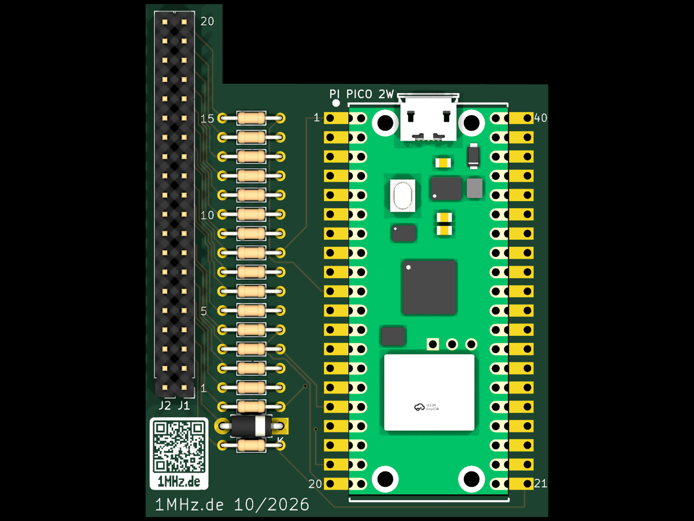
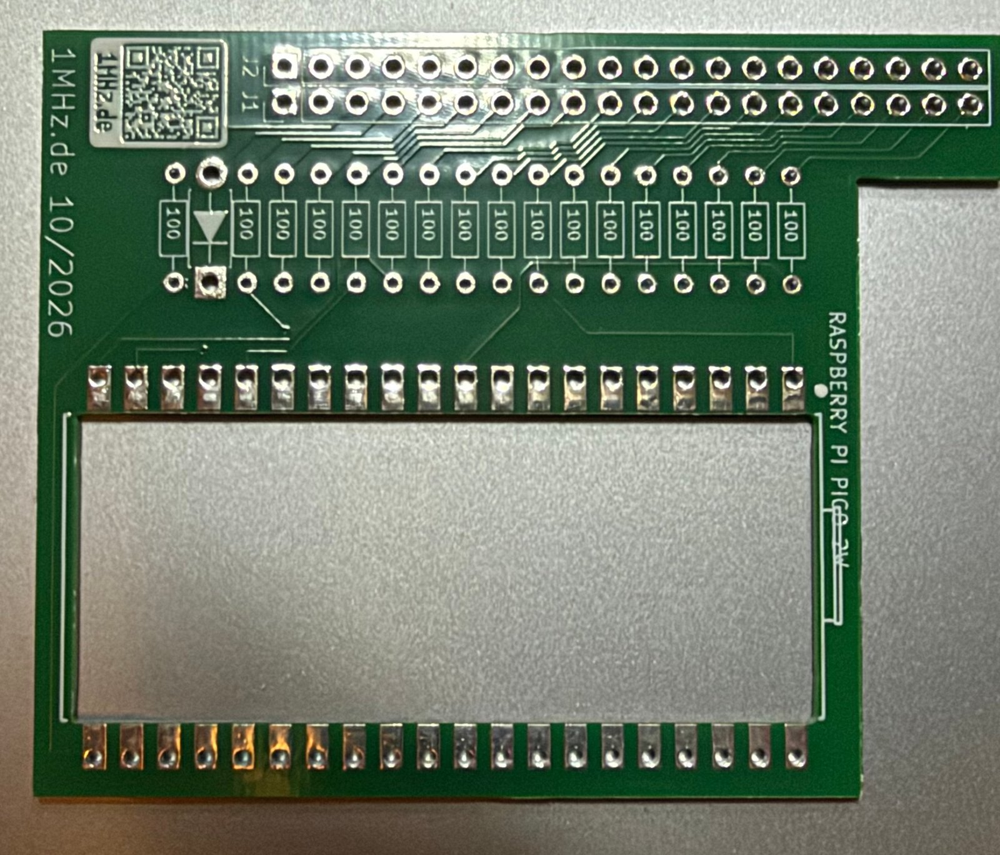

# Hardware (Platine)

[English](README.md)

Platine für **Pico64 Keyboard**: ein Zwischenstecker für den C64-Tastaturanschluss CN1, der
Raspberry Pi Pico 2 W wird **flach in eine Aussparung** gelötet (Castellated-Kanten), dazu
17 × 100 Ω und eine Schottky-Diode – passt unter das Gehäuseoberteil. Im Brotkasten-C64 getestet.

| | |
|---|---|
|  |  |
| bestückt | im C64 (auf CN1, Tastaturkabel oben drauf) |
|  |  |
| 3D-Ansicht (KiCad) | unbestückte Platine |

## Dateien

| Datei | |
|---|---|
| [gerber/pico64-keyboard-gerber-v1.1.zip](gerber/pico64-keyboard-gerber-v1.1.zip) | Gerber- und Bohrdaten, fertig für den Platinenhersteller (2 Lagen, 1,6 mm) |
| [Pico64-keyboard-bom.csv](Pico64-keyboard-bom.csv) | Stückliste |

v1.1: keine Bohrungen an Pin 2 von J1/J2 (Kodierung des Steckers) und Pin-Nummern im
Bestückungsdruck. Die Platinen auf den Fotos sind v1.0 – sonst identisch.

## Bauteile

| Anzahl | Bauteil | |
|---|---|---|
| 1 | Raspberry Pi Pico 2 W | ohne Stiftleisten, flach an den Castellated-Kanten verlötet |
| 17 | Widerstand 100 Ω, 1/4 W (DIN0204, 7,62 mm) | R1–R17 |
| 1 | Schottky-Diode 1N5817 (DO-41) | D1, Anode an +5 V vom C64 |
| 1 | Buchsenleiste 1 × 20, 2,54 mm | J2, auf CN1 der Hauptplatine |
| 1 | Stiftleiste 1 × 20, 2,54 mm | J1, hier kommt der Stecker des Tastaturkabels drauf |

Platine 53 × 68 mm (mit dem Arm für den Stecker), 2 Lagen, 1,6 mm. Das Einlöten des Pico in die Aussparung braucht etwas
Geduld – Pads verzinnen, dann Kante für Kante löten.

Verdrahtung, Pin-Tabelle und Sicherheitshinweise: [../docs/HARDWARE.md](../docs/HARDWARE.md) (englisch).

**Vor dem Einstecken:** die Belegung von CN1 am eigenen C64 mit dem Multimeter prüfen (GND Pin 1,
+5 V Pin 4, RESTORE Pin 3).

## Lizenz

CC BY-NC-SA 4.0, siehe [../LICENSE-HARDWARE.md](../LICENSE-HARDWARE.md).
