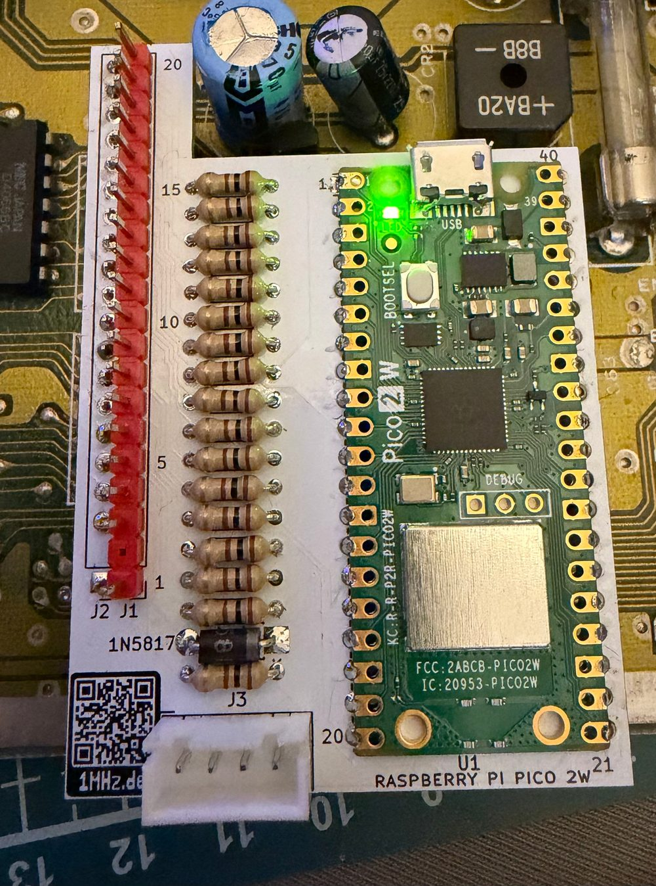
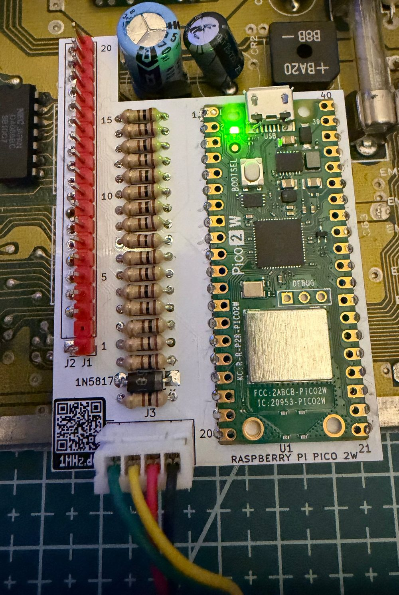
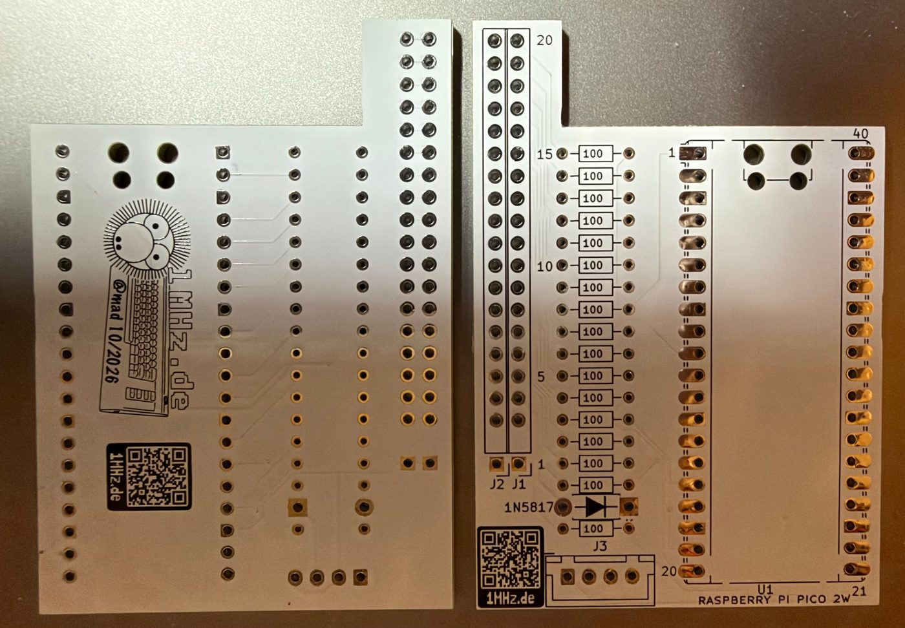

# Hardware (Platine)

[English](README.md)

Platine **V2** für **Pico64 Keyboard**: ein Zwischenstecker für den C64-Tastaturanschluss CN1 mit
einem Raspberry Pi Pico 2 W, 17 × 100 Ω, einer Schottky-Diode und der Buchse J3 für das
[CBM2 Keyboard](https://github.com/do2mad/cbm2-keyboard). 47 × 68 mm, 2 Lagen, 1,6 mm, nur
bedrahtete Bauteile. Im Brotkasten-C64 getestet.

| | |
|---|---|
|  |  |
| V2 im C64, Pico direkt aufgelötet | mit Kabel zum CBM2 Keyboard an J3 |

*V2 unbestückt – links die Unterseite, rechts die Oberseite.*

## Dateien

| Datei | |
|---|---|
| [kicad/](kicad/) | **KiCad-Projekt** (KiCad 10): Schaltplan, Platine, alle Symbole, Footprints und 3D-Modelle im Projektordner – öffnen mit `kicad/Pico64-keyboard-V2.kicad_pro` |
| [gerber/pico64-keyboard-gerber-v2.0.zip](gerber/pico64-keyboard-gerber-v2.0.zip) | Gerber- und Bohrdaten, fertig für den Platinenhersteller |
| [Pico64-keyboard-V2-bom.csv](Pico64-keyboard-V2-bom.csv) | Stückliste |

Unter der Antenne des Pico 2 W hat die Platine einen Ausschnitt (besserer Funkempfang).

## Pico aufsetzen

- **Direkt aufgelötet** (wie auf dem Foto): Pico ohne Stiftleisten flach auf die Pads legen und an
  den Castellated-Kanten verlöten. Das ist die niedrigste Bauform und passt unter das Gehäuseoberteil.
- **Gesteckt:** Stiftleisten an den Pico, Buchsenleisten auf die Platine – der Pico lässt sich dann
  abnehmen. Vorher die Bauhöhe im eigenen C64-Gehäuse prüfen.

## Bauteile

| Anzahl | Bauteil | |
|---|---|---|
| 1 | Raspberry Pi Pico 2 W | U1, aufgelötet oder gesteckt (dann 2 × Stift- und Buchsenleiste 1 × 20) |
| 17 | Widerstand 100 Ω, 1/4 W (DIN0204, 7,62 mm) | R1–R17 |
| 1 | Schottky-Diode 1N5817 (DO-41) | D1, Anode an +5 V vom C64 |
| 1 | Buchsenleiste 1 × 20, 2,54 mm | J2, unten, auf CN1 der Hauptplatine |
| 1 | Stiftleiste 1 × 20, 2,54 mm | J1, oben, hier kommt der Stecker des Tastaturkabels drauf |
| 1 | JST-XH-Buchse 4-polig, stehend (B4B-XH-A) | J3, Kabel zum CBM2 Keyboard – nur nötig, wenn man es nutzt |

## J3 – Kabel zum CBM2 Keyboard

| J3 | Pico64 | |
|---|---|---|
| 1 | GP17 (Pin 22) | Daten vom CBM2 Keyboard, 115200 Baud |
| 2 | GND | Kabel-Erkennung für das CBM2 Keyboard |
| 3 | VSYS (hinter D1) | Strom für das CBM2 Keyboard |
| 4 | GND | |

Das Kabel ist 1:1 verdrahtet. Firmware ab **0.13.1**. Ohne Kabel ändert sich nichts.

## Vor dem Einstecken

Die Belegung von CN1 am eigenen C64 mit dem Multimeter prüfen (GND Pin 1, +5 V Pin 4, RESTORE
Pin 3). Verdrahtung, Pin-Tabelle und Sicherheitshinweise: [../docs/HARDWARE.de.md](../docs/HARDWARE.de.md).

Die frühere V1 (Pico in einer Aussparung der Platine) ist durch V2 ersetzt.

## Lizenz

CC BY-SA 4.0, siehe [../LICENSE-HARDWARE.md](../LICENSE-HARDWARE.md). Die 3D-Modelle in
`kicad/3d/` stammen aus den KiCad-Bibliotheken, siehe [../NOTICE](../NOTICE).
