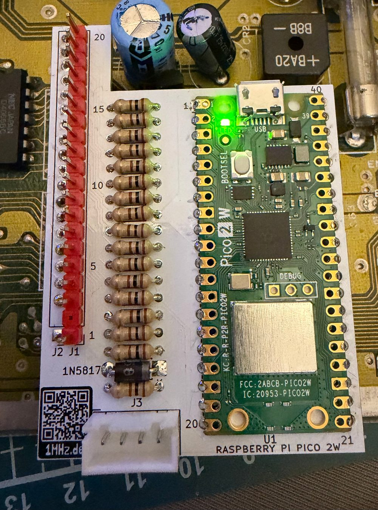
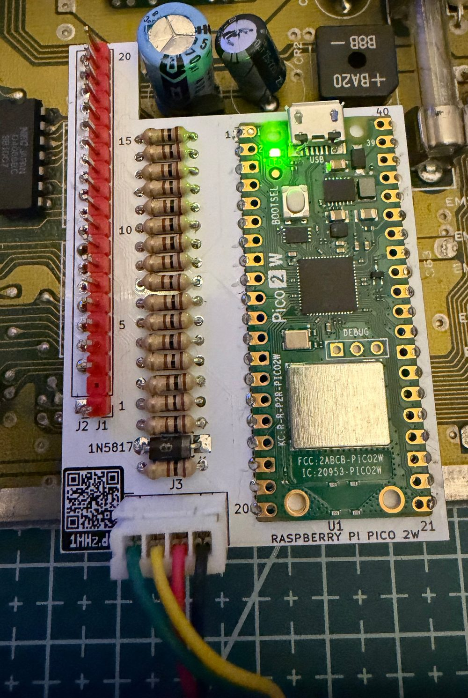
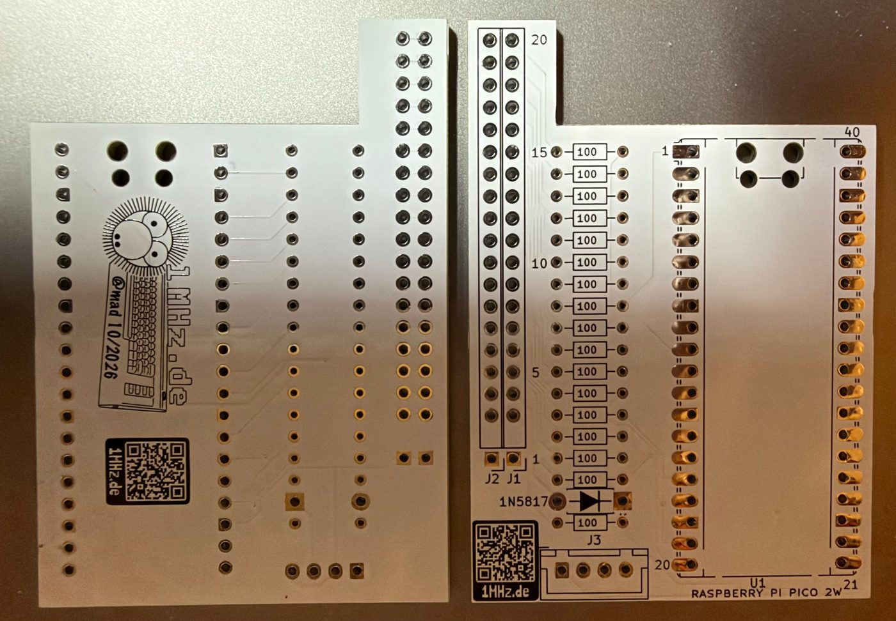

# Hardware (PCB)

[Deutsch](README.de.md)

PCB **V2** for **Pico64 Keyboard**: a pass-through adapter for the C64 keyboard connector CN1 with
a Raspberry Pi Pico 2 W, 17 × 100 Ω, a Schottky diode and the socket J3 for the
[CBM2 Keyboard](https://github.com/do2mad/cbm2-keyboard). 47 × 68 mm, 2 layers, 1.6 mm,
through-hole parts only. Tested in a breadbin C64.

| | |
|---|---|
|  |  |
| V2 in the C64, Pico soldered directly | with the cable to the CBM2 Keyboard on J3 |

*V2 bare – bottom side on the left, top side on the right.*

## Files

| File | |
|---|---|
| [kicad/](kicad/) | **KiCad project** (KiCad 10): schematic, PCB, all symbols, footprints and 3D models inside the project folder – open `kicad/Pico64-keyboard-V2.kicad_pro` |
| [gerber/pico64-keyboard-gerber-v2.0.zip](gerber/pico64-keyboard-gerber-v2.0.zip) | Gerber and drill files, ready for the PCB maker |
| [Pico64-keyboard-V2-bom.csv](Pico64-keyboard-V2-bom.csv) | parts list |

The PCB has a cut-out under the antenna of the Pico 2 W (better radio reception).

## Mounting the Pico

- **Soldered directly** (as in the photo): place the Pico without pin headers flat on the pads and
  solder the castellated edges. This is the lowest option and fits under the case top.
- **Plugged in:** pin headers on the Pico, sockets on the PCB – the Pico can then be removed.
  Check the height inside your own C64 case first.

## Parts

| Qty | Part | |
|---|---|---|
| 1 | Raspberry Pi Pico 2 W | U1, soldered or plugged in (then 2 × pin header and socket 1 × 20) |
| 17 | Resistor 100 Ω, 1/4 W (DIN0204, 7.62 mm) | R1–R17 |
| 1 | Schottky diode 1N5817 (DO-41) | D1, anode at +5 V from the C64 |
| 1 | Female header 1 × 20, 2.54 mm | J2, bottom, onto CN1 on the mainboard |
| 1 | Male header 1 × 20, 2.54 mm | J1, top, takes the keyboard cable plug |
| 1 | JST-XH socket 4-pin, vertical (B4B-XH-A) | J3, cable to the CBM2 Keyboard – only needed if you use it |

## J3 – cable to the CBM2 Keyboard

| J3 | Pico64 | |
|---|---|---|
| 1 | GP17 (pin 22) | data from the CBM2 Keyboard, 115200 baud |
| 2 | GND | cable detect for the CBM2 Keyboard |
| 3 | VSYS (after D1) | power for the CBM2 Keyboard |
| 4 | GND | |

The cable is wired 1:1. Firmware **0.13.1** or newer. Nothing changes without the cable.

## Before plugging in

Check the CN1 pinout of your own C64 with a multimeter (GND pin 1, +5 V pin 4, RESTORE pin 3).
Wiring, pin table and safety notes: [../docs/HARDWARE.md](../docs/HARDWARE.md).

The earlier V1 (Pico in a cut-out of the PCB) is replaced by V2.

## Licence

CC BY-SA 4.0, see [../LICENSE-HARDWARE.md](../LICENSE-HARDWARE.md). The 3D models in
`kicad/3d/` come from the KiCad libraries, see [../NOTICE](../NOTICE).
